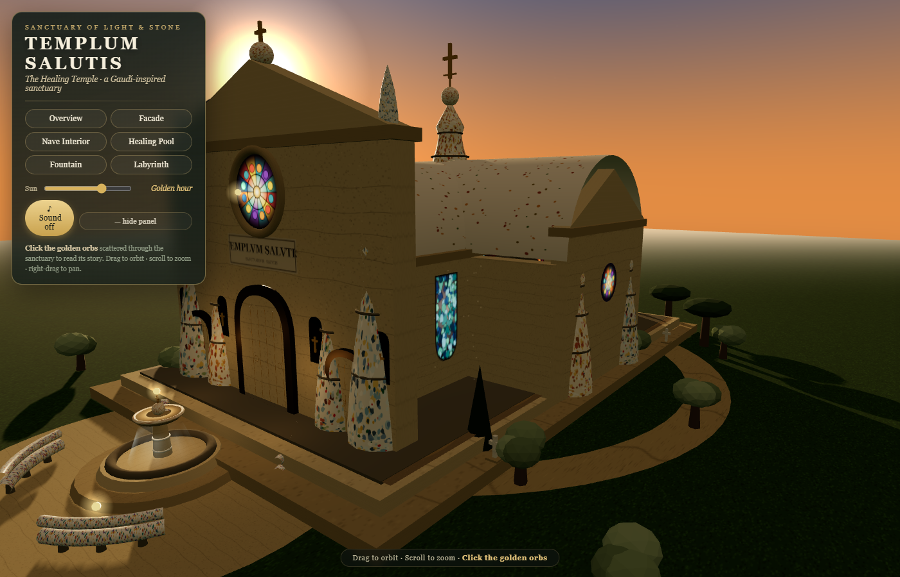

# Templum Salutis — The Healing Temple



**Live: https://templum-salutis.victoryman-kang.workers.dev** (Cloudflare Pages — now part of Cloudflare Workers). Redeploy with `node scripts/build-dist.mjs && npx wrangler pages deploy dist --project-name=templum-salutis`.

An interactive 3D sanctuary in the spirit of Antoni Gaudí — mosaic-tipped spires, a branching "forest of stone", a healing pool in the apse, and gardens with a meditation labyrinth. **100% procedural geometry and textures — no external assets.**

## Run it

**First run (fresh clone):** copy `.env.example` to `.env` and fill in your Supabase keys
(the publishable key from your Supabase dashboard → Settings → API):

```bash
copy .env.example .env   # then edit .env
```

Double-click **`run.bat`** (regenerates `js/config.js` from `.env`, starts a local server,
opens your browser at <http://localhost:8123>), or run manually:

```bash
node scripts/gen-config.mjs     # builds js/config.js from .env (required — it is gitignored)
cd C:\Users\quant\healing-temple
python -m http.server 8123
```

> A local server is required — ES modules do not load over `file://`.
> `.env` and `js/config.js` are **gitignored** — the key never lands in the repo.

## What's inside

- **Cruciform basilica** — nave + transepts + rounded apse, cruciform plan, vaulted in pale plaster inside and trencadís ceramic outside
- **10 trencadís spires + central "Tower of Jesus"** with four-armed golden cross
- **Facade** — three pointed-arch bronze portals, glowing rose window, Latin plaque `TEMPLVM SALVTIS`, gold-cross niches
- **Interior** — 12 branching tree columns (porphyry & basalt), altar, great golden cross, **healing pool**, 14 flickering candles, drifting dust motes, warm light pools from the stained glass
- **Grounds** — stone plaza + fountain (*Font de la Vida*), Park Güell-style serpentine trencadís benches, entrance gate with plaque, cypress avenue, olive groves, stone pines, lavender beds, **meditation labyrinth**, ring path with 4 trencadís stations
- **Three selectable pilgrims** — **Brother Martin** (monk · brown habit), **Sister Lucia** (nun · plum habit) and **Novice Pip** (child monk · mossy hooded habit, rosy cheeks). Choose on arrival, then **walk** them from the gate, up the plinth steps, through the portals and around the nave — full third-person walking with collision, footsteps, blinking and idle-breathing animations. A floating **nameplate** shows your account name (or theirs, for guests)
- **Kneel to pray** — press **N** (or the panel button) anywhere on the grounds: the pilgrim kneels, the camera leans in, and a soft bell chimes (a special quiet word at the Healing Pool); press again to rise
- **Time-of-day slider** — morning → midday → golden hour → dusk (windows blaze, candles and stars wake at dusk)
- **Ambient generative audio** — wind, birdsong, a singing-bowl drone (396/528 Hz) and deep bells every ~30 s (toggle with *Sound*)
- **7 clickable golden orbs** tell the sanctuary's story

## Controls

| Input | Action |
|---|---|
| Drag | Orbit |
| Scroll | Zoom |
| Right-drag | Pan |
| View buttons | Cinematic jumps (fade transition) |
| Golden orbs | Story popup |
| **W A S D / arrows** (walk mode) | Walk |
| **Drag** (walk mode) | Look around |
| **Shift** (walk mode) | Run |
| **Esc** | Exit walk mode |
| Switch pilgrim link | Re-open the pilgrim chooser |

## Optional: accounts & the Prayer Wall (Supabase)

The temple works fully without an account. Signing in unlocks **The Prayer Wall** —
visitors can leave a short intention for anyone to read (one per account per submit,
280 characters, withdrawable any time) — and syncs your **pilgrim choice** across devices.

**Already wired:** `js/config.js` holds the publishable key (safe to ship — access is
guarded by Row Level Security), `js/auth.js` handles sessions and the wall, the UI lives
in `index.html`, and `vendor/supabase.umd.js` runs fully offline-capable.

**One-time setup (2 minutes, do this to switch the wall on):**

1. Supabase Dashboard → **SQL Editor** → New query → paste **`supabase/schema.sql`** → **Run**
   (creates `public.prayers` with RLS: world-readable, insert/delete only your own rows)
2. **Authentication → Providers → Email** — make sure it's enabled.
   - *Confirm email ON* (default): visitors must click the link in their inbox before first sign-in; the modal handles this state.
   - *Confirm email OFF*: instant signup — nicer for demos.
3. That's it. Sign in button appears top-right after entering the sanctuary; **🕯 Prayer Wall** opens bottom-right.

**Before the schema runs,** the wall shows: *"The wall is not built yet — run supabase/schema.sql…"* (expected, by design).

## Project layout

| Path | Purpose |
|---|---|
| `index.html` | UI shell, import map, pilgrim overlay, auth modal, prayer wall |
| `js/main.js` | Scene: basilica, grounds, lighting, interaction, audio, accounts wiring |
| `js/textures.js` | Canvas-generated textures & sprites |
| `js/config.js` | Supabase URL + publishable key (safe to ship; RLS-guarded) |
| `js/auth.js` | Supabase auth (email/password), session, pilgrim sync, prayer-wall CRUD; fails soft |
| `supabase/schema.sql` | `prayers` table + RLS policies — run once in the SQL editor |
| `vendor/` | three@0.160.0, OrbitControls, supabase.umd.js (local, offline-friendly) |
| `PROCESS.md` | **Build log — read this before upgrading** |

Verified headlessly (Chrome + SwiftShader): no console/page errors; all 6 camera presets render correctly; dusk lighting checked.

## Upgrade ideas

See `PROCESS.md → Upgrade backlog` (photo mode, WebXR, day–night cycle, denser facade sculpture, geometry merging/LOD, accessibility, localization).
